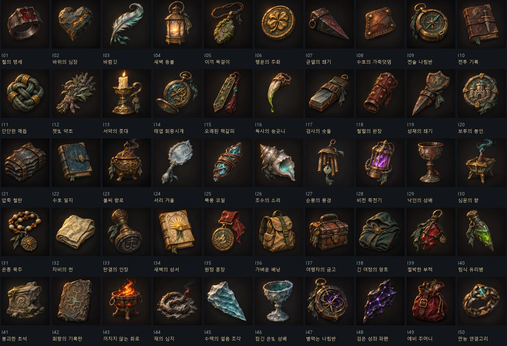

# 유물 이미지 50종

유물 I01–I50 각각에 독립적인 정사각형 PNG 이미지를 제작했다. 기존 몬스터 삽화와 어울리는 어두운 판타지 질감, 낡은 금속과 가죽, 제한된 마법 발광을 사용한다. 이미지 자체에는 글자나 카드 테두리가 없다.

- 저장: `Assets/BRODUN/Art/Relics/Resources/BrodunRelics/I01.png`–`I50.png`.
- 제작 도구: 기본 내장 `image_gen`. 생성 원본을 수정 없이 복사했다.
- 최종 프롬프트: `RelicArtPrompts.json`의 공통 `style` 뒤에 각 `subject`를 붙인다.
- 매칭과 원본 크기·해시: `RelicArtManifest.json`.
- Unity: 단일 Sprite, 최대 임포트 크기 512, Bilinear, mipmap 비활성. 원본 PNG는 별도로 보존된다.
- 표시: 전투/맵의 보유 유물 목록, 성소 아이템 구매·판매 목록. 이름과 효과는 기존 UI 텍스트를 유지한다.

50개 ID와 파일 일치, PNG 디코딩, 서로 다른 이미지 해시와 Unity GUID, Sprite 설정을 검사했다. 전체 런타임 및 테스트 소스 컴파일은 경고 0개·오류 0개로 통과했다. Unity 에디터에서 실제 Sprite 임포트와 게임 화면 확인은 아직 수행하지 않았다. `RelicArtTests`는 에디터에서 50개 Sprite의 로드와 중복 여부를 검증하기 위한 테스트이며 이 작업에서 실행한 결과로 간주하지 않는다.
